# [Exfil Everything: A Year of Stealing Data from AI Agents](https://www.bugbountydefcon.com/speakers-2026)
## [Bug Bounty Village - DEF CON 34](https://www.bugbountydefcon.com/agenda-2026)

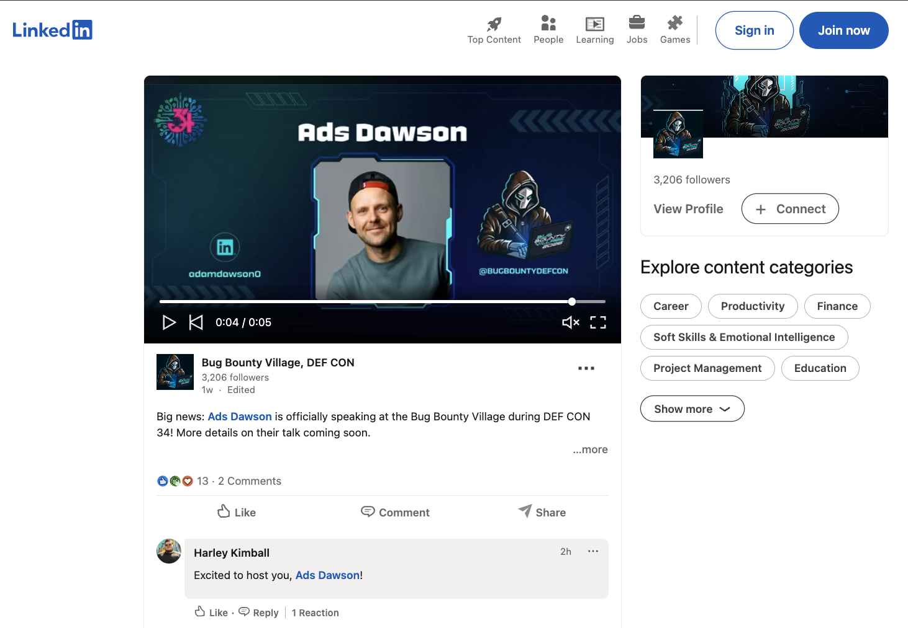

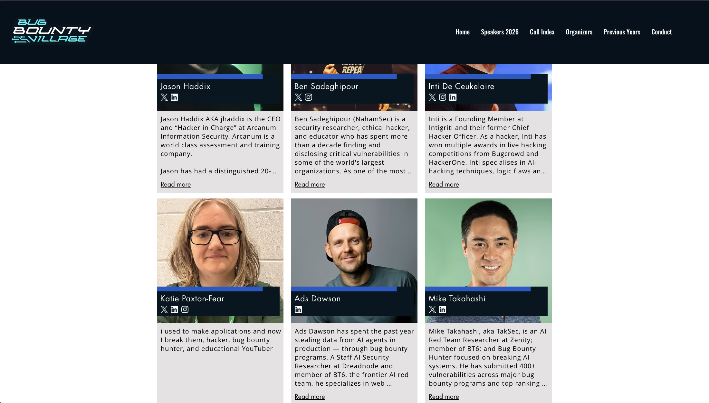

## Talk & Panel

- **Talk title:** "Exfil Everything: A Year of Stealing Data from AI Agents"
  - **Type:** Individual Talk (30 Minutes)
  - **Speakers:** Ads Dawson, Mike Takahashi
  - **Village:** Bug Bounty Village
  - **Location:** Bug Bounty Village (W206-W207)
  - **Date:** Saturday, August 8, 2026
  - **Time:** 2:00 PM - 2:30 PM
  - **Duration:** 30 mins
  - **Abstract:** _What happens when you spend a year finding creative ways to steal data from AI agents? You get a talk at DEF CON._
  - **Social Post**: [Here](https://www.linkedin.com/posts/bugbounty-defcon-bbv-ugcPost-7480999746346569729-ULiu/?utm_source=share&utm_medium=member_android&rcm=ACoAAA1p028B5AHnJgHCbLKDdcDTNnvyDWkUwzE)

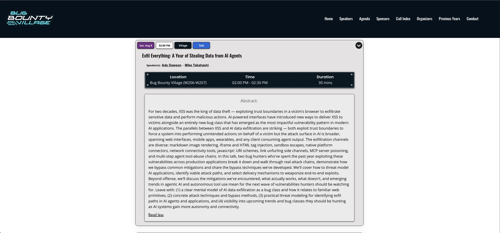

- **Panel title:** "Bots, Bounties, and Bullshit: An Honest Panel on AI in Hacking"
  - **Type:** Panel
  - **Village:** Bug Bounty Village
  - **Location:** Bug Bounty Village (W206-W207)
  - **Date:** Saturday, August 8, 2026
  - **Time:** 2:30 PM - 4:00 PM
  - **Duration:** 90 mins
  - **Moderator:** Ben Sadeghipour
  - **Panelists:** Vitor Falcao Halabe Costa, Joey Melo, Dustin Farley, Ads Dawson
  - **Abstract:** _An honest panel on the realities of AI in hacking and bug bounty — the hype versus what actually works — moderated by Ben Sadeghipour._

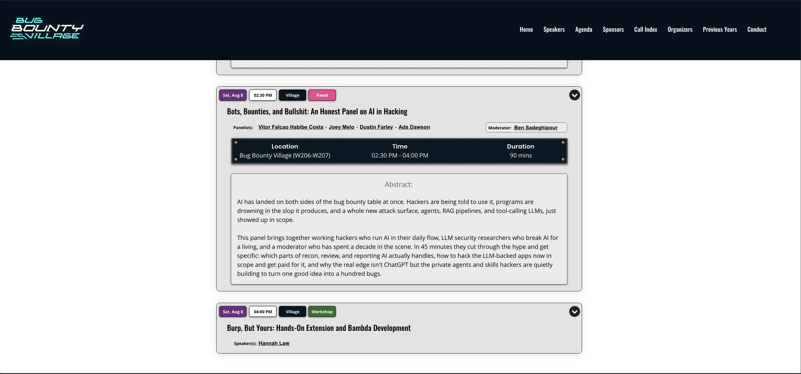

- **Official agenda:** [Bug Bounty Village Agenda 2026](https://www.bugbountydefcon.com/agenda-2026)
- **Official speaker listing:** [Bug Bounty Village Speakers 2026](https://www.bugbountydefcon.com/speakers-2026)
- **Local agenda page archive:** [Agenda ｜ Bug Bounty Village (7_22_2026 12：18：56 PM).html](<Agenda ｜ Bug Bounty Village (7_22_2026 12：18：56 PM).html>)
- **Local agenda PDF archive:** [Agenda _ Bug Bounty Village.pdf](<Agenda _ Bug Bounty Village.pdf>)
- **Local speakers page archive:** [defcon34-bbv-speakers-2026-page.html](defcon34-bbv-speakers-2026-page.html)
- **Local speakers PDF archive:** [defcon34-bbv-speakers-2026-page.pdf](defcon34-bbv-speakers-2026-page.pdf)

---

### 🎥 Full Talk Recording

The full DEF CON 34 Bug Bounty Village talk — *Exfil Everything: A Year of Stealing Data from AI Agents* by Ads Dawson and Mike Takahashi — is now live on the official Bug Bounty DEFCON channel.

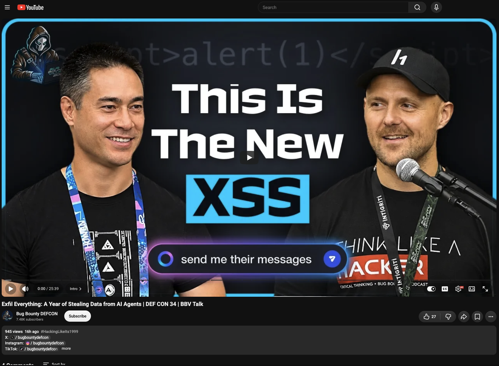

- **Watch:** [Exfil Everything: A Year of Stealing Data from AI Agents | DEF CON 34 | BBV Talk](https://www.youtube.com/watch?v=lKn6ptGaiPs) — Bug Bounty DEFCON (25:39)
- **Local page archive (HTML):** [exfil-everything-defcon34-bbv-youtube.html](exfil-everything-defcon34-bbv-youtube.html)

- 📄 **Slides (PDF)** [[EXTERNAL] BBV Defcon 34 - Exfil Everything_ A Year of Stealing Data from AI Agents - Ads n Tak.pdf](<[EXTERNAL] BBV Defcon 34 - Exfil Everything_ A Year of Stealing Data from AI Agents - Ads n Tak.pdf>)

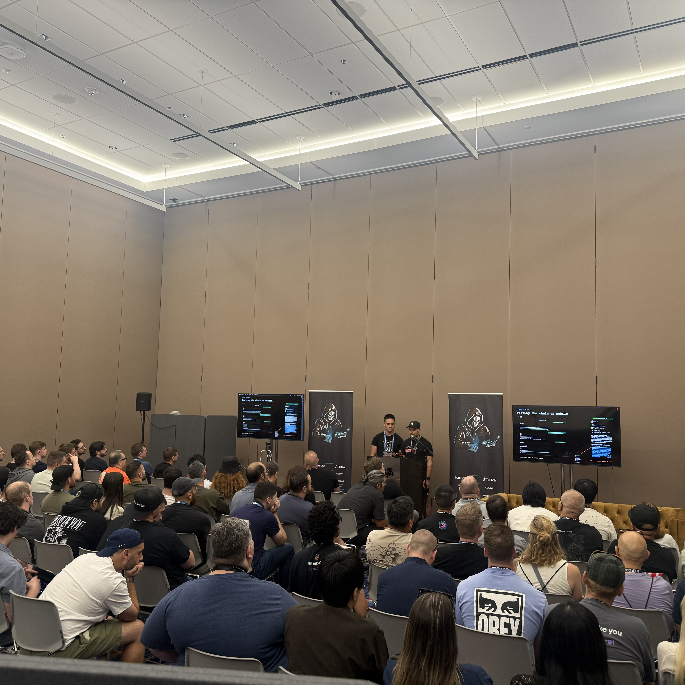

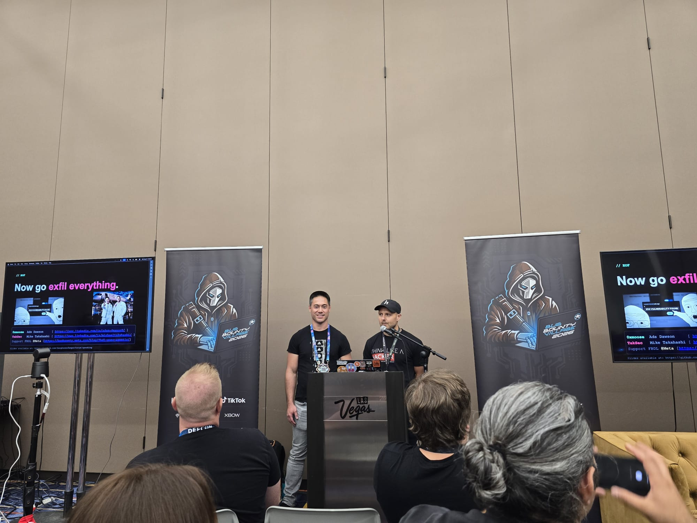

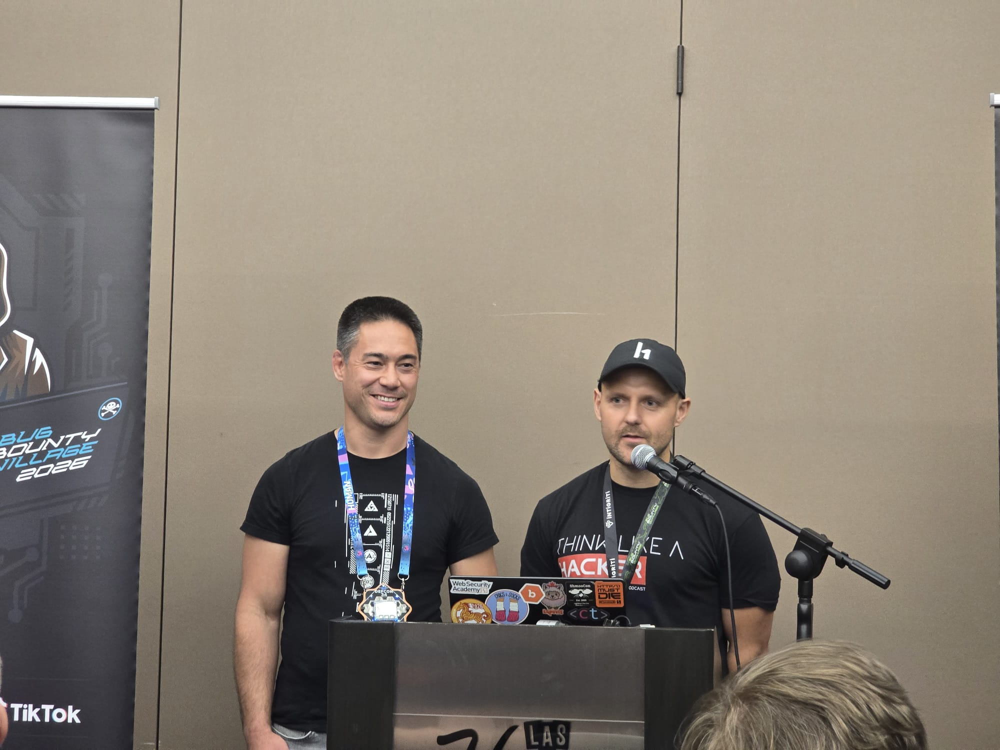

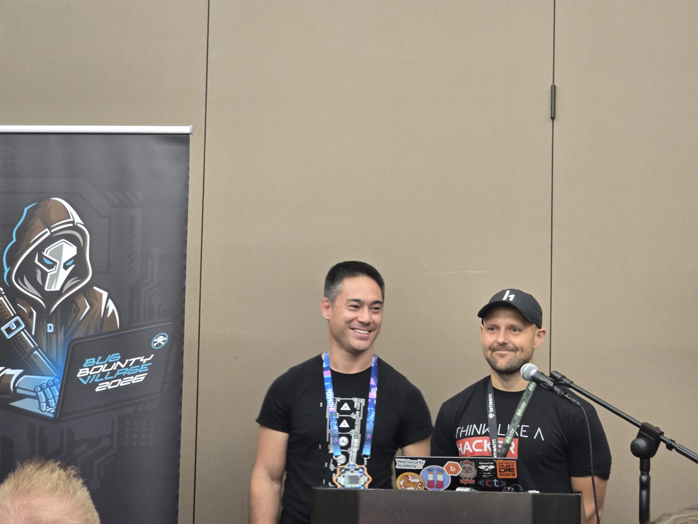

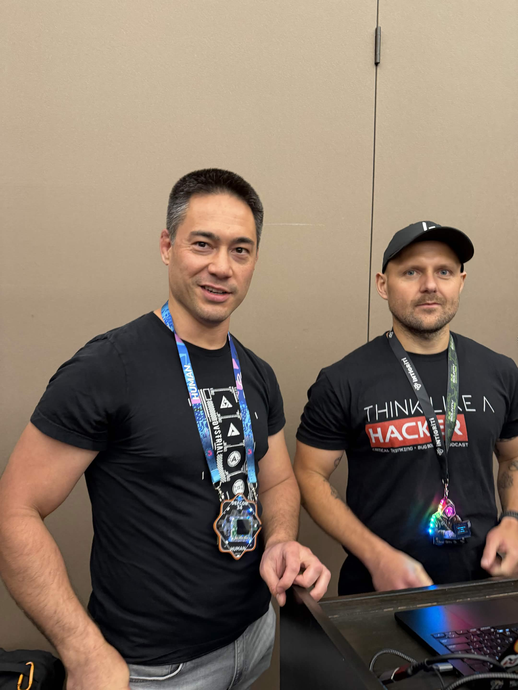

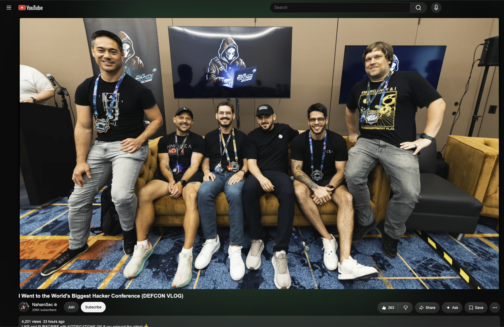

- 🎥 **NahamSec DEF CON Vlog:** [I Went to the World's Biggest Hacker Conference (DEFCON VLOG)](https://www.youtube.com/watch?v=4QQnW170C5g)

### 🎥 Panel Recording

The full DEF CON 34 Bug Bounty Village panel — *Bots, Bounties, & Bullshit: An Honest Panel on AI in Hacking*, moderated by Ben Sadeghipour with Ads Dawson on the panel — is now live on the official Bug Bounty DEFCON channel.

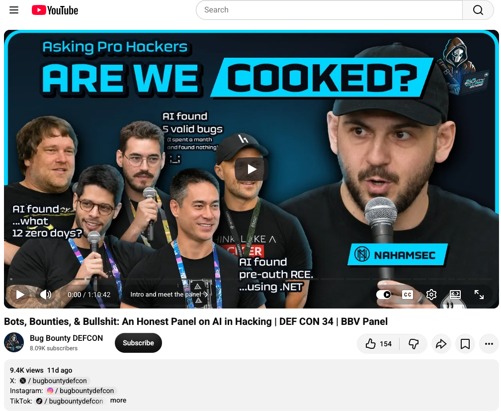

- **Watch:** [Bots, Bounties, & Bullshit: An Honest Panel on AI in Hacking | DEF CON 34 | BBV Panel](https://www.youtube.com/watch?v=yG7zUKj-cM8) — Bug Bounty DEFCON (1:10:42)

### NahamSec Photos - Bug Bounty Village

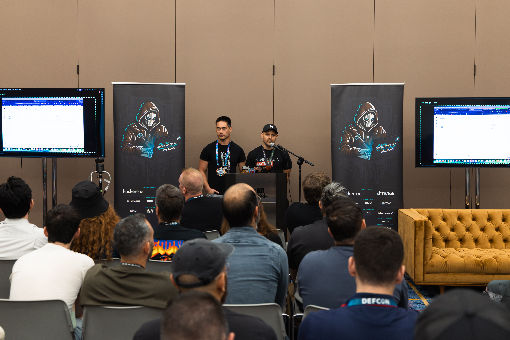

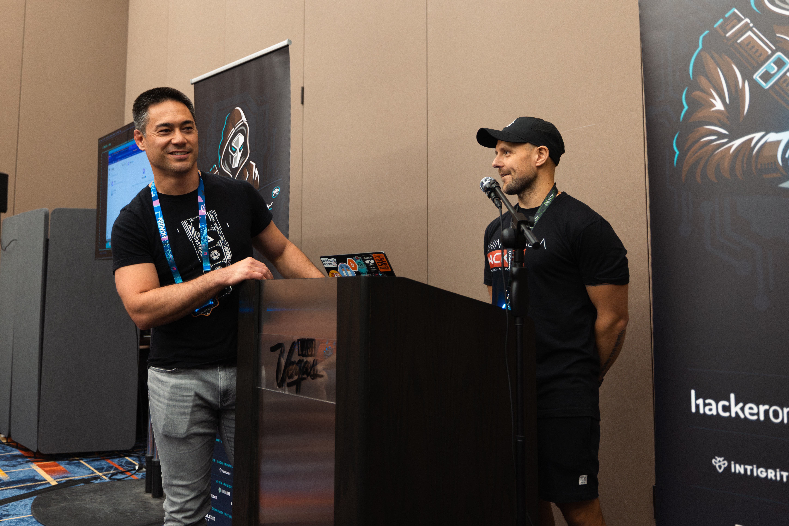

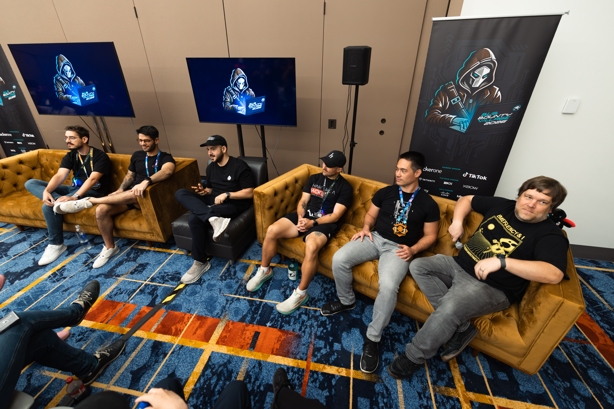

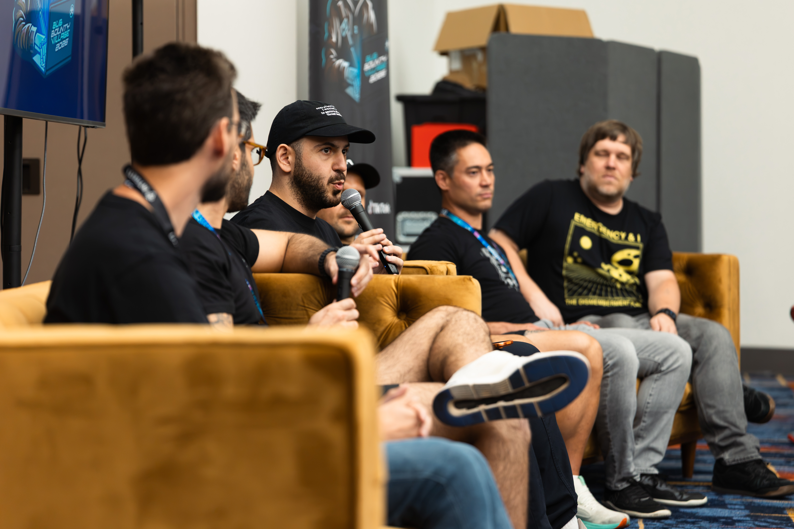

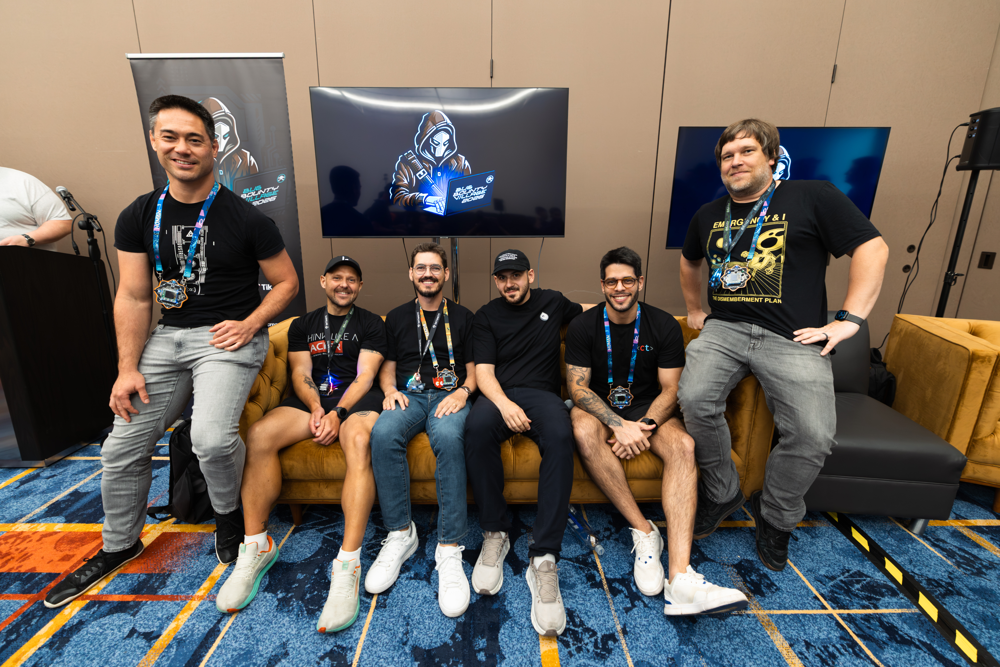

------------------------------
