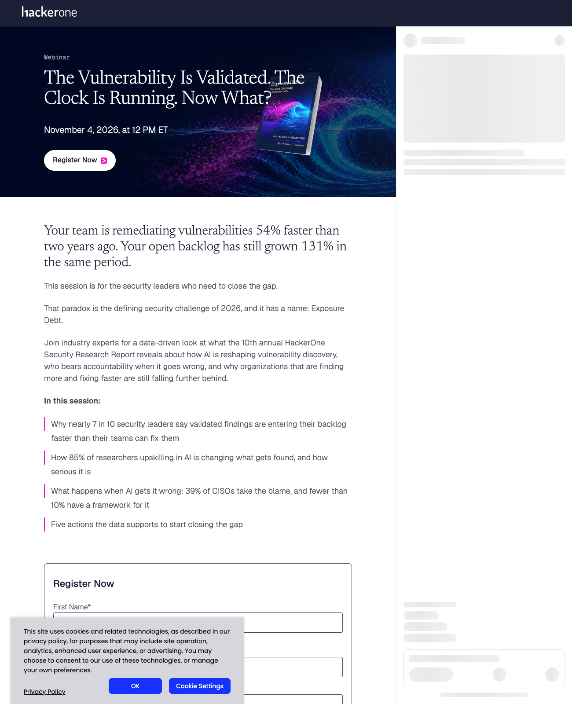
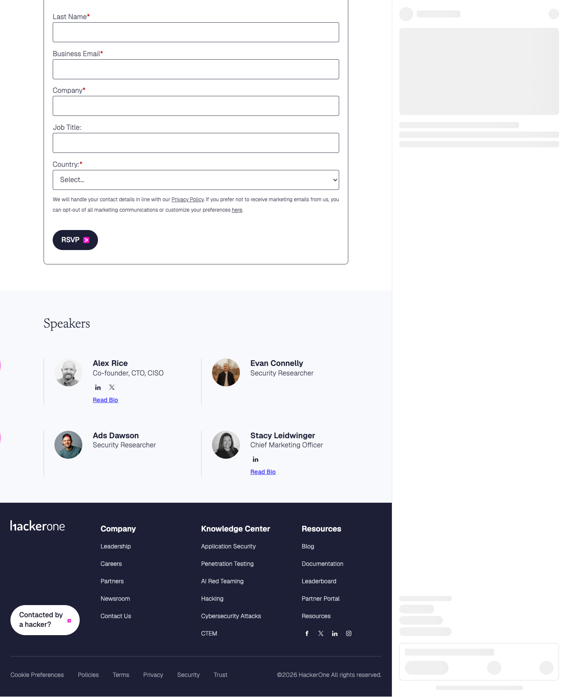
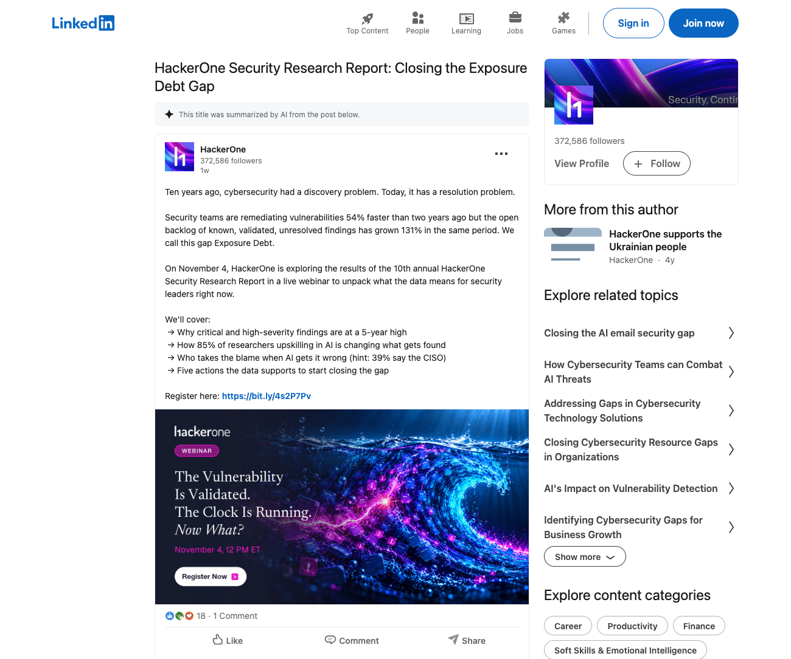

# [HackerOne Webinar: The Vulnerability Is Validated. The Clock Is Running. Now What?](https://www.hackerone.com/events/hackerone-security-report-webinar)
## [10th Annual HackerOne Security Research Report — Closing the Exposure Debt Gap](https://www.hackerone.com/events/hackerone-security-report-webinar)

- **Organizer:** HackerOne
- **Event:** The Vulnerability Is Validated. The Clock Is Running. Now What?
- **Format:** Live Webinar (Panel)
- **Date:** Wednesday, November 4, 2026
- **Time:** 12:00 PM ET
- **Description:** A data-driven look at what the 10th Annual HackerOne Security Research Report reveals about **Exposure Debt** — the gap between faster remediation and a growing backlog of known, validated, unresolved findings — plus how AI is reshaping vulnerability discovery and who bears accountability when it goes wrong.

### Speakers

- **Alex Rice** — Co-founder, CTO & CISO, HackerOne
- **Evan Connelly** — Security Researcher
- **Ads Dawson** — Security Researcher
- **Stacy Leidwinger** — Chief Marketing Officer, HackerOne

### In This Session

- Why nearly 7 in 10 security leaders say validated findings are entering their backlog faster than their teams can fix them
- How 85% of researchers upskilling in AI is changing what gets found, and how serious it is
- What happens when AI gets it wrong: 39% of CISOs take the blame, and fewer than 10% have a framework for it
- Five actions the data supports to start closing the gap

> Your team is remediating vulnerabilities 54% faster than two years ago. Your open backlog has still grown 131% in the same period. That paradox is the defining security challenge of 2026, and it has a name: **Exposure Debt.**

### Links

- **Registration page:** [The Vulnerability Is Validated. The Clock Is Running. Now What? — HackerOne](https://www.hackerone.com/events/hackerone-security-report-webinar)
- **LinkedIn post:** [HackerOne — "Ten years ago, cybersecurity had a discovery problem. Today, it has a resolution problem."](https://www.linkedin.com/posts/hackerone_ten-years-ago-cybersecurity-had-a-discovery-activity-7516508693409198080-8ACu)
- **Local registration page archive:** [hackerone-security-report-webinar-page.html](hackerone-security-report-webinar-page.html)
- **Local LinkedIn post archive:** [hackerone-security-report-webinar-linkedin.html](hackerone-security-report-webinar-linkedin.html)

> **Status:** Upcoming. Registration page and LinkedIn announcement captured; local HTML archives and browser screenshots (event page, speakers, LinkedIn post) saved.
