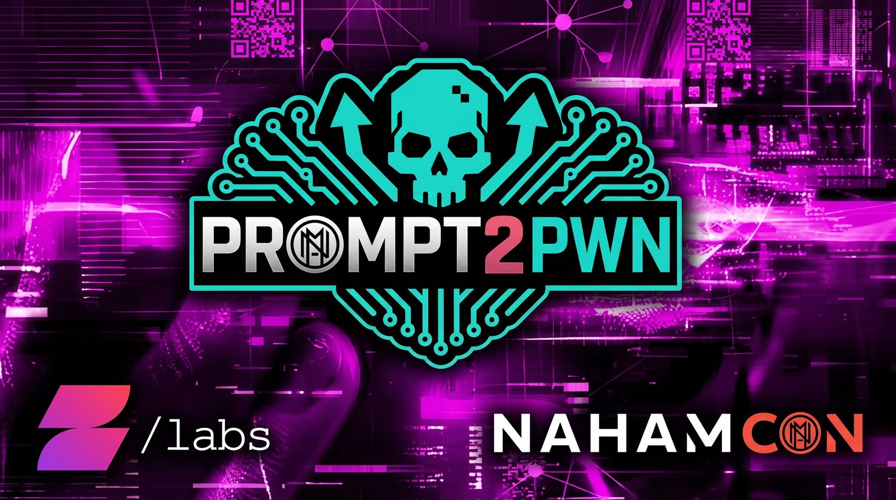
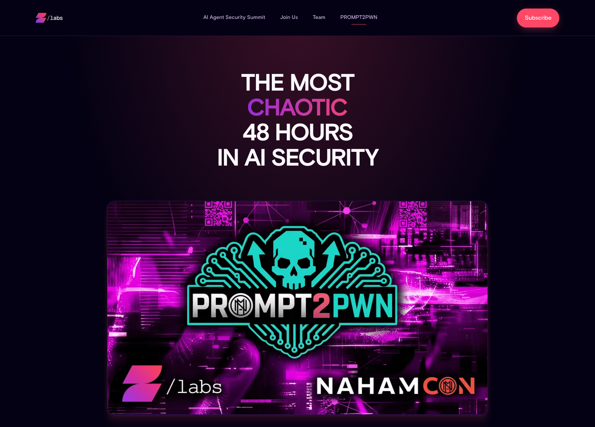
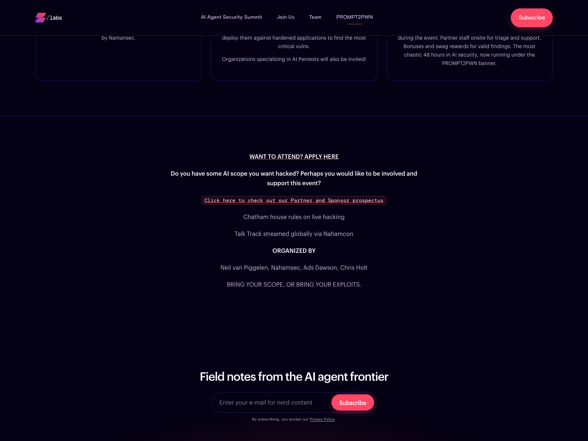
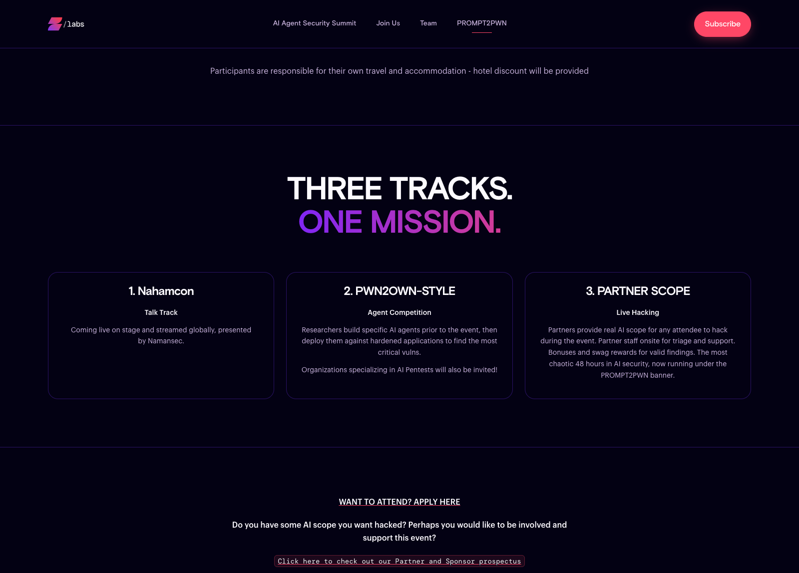
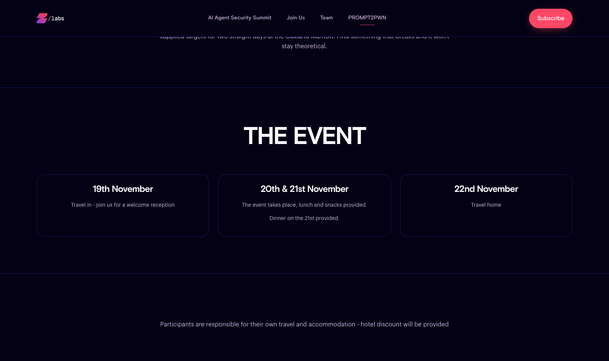
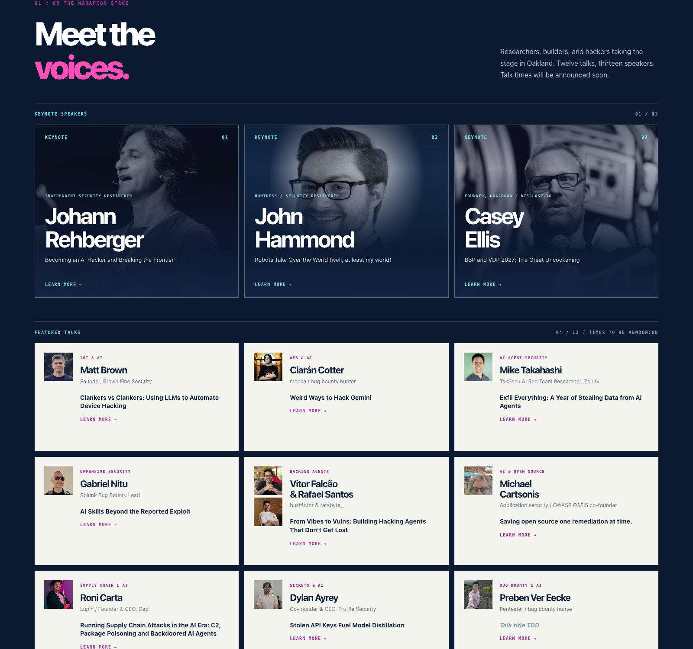
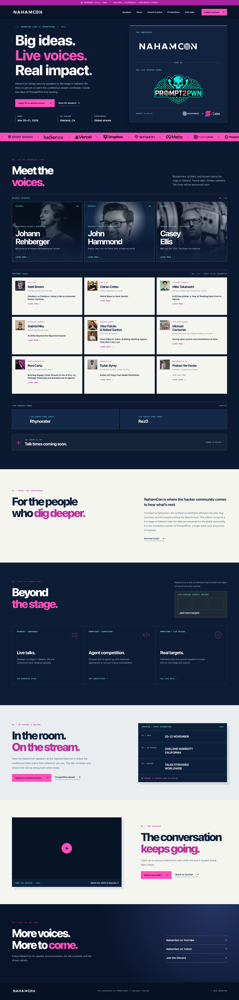

# [NahamCon 2026 @ Prompt2Pwn](https://p2p.nahamcon.com/)
## [Organizer & Board Member — the most chaotic 48 hours in AI security](https://labs.zenity.io/prompt2pwn)

- **Organizer:** Zenity Labs & NahamSec
- **Event:** Prompt2Pwn (live AI hacking) with NahamCon 2026 as its conference track
- **Role:** Organizer / Board Member — credited on the Prompt2Pwn organizing team
- **Format:** In-person live hacking event + conference talks streamed worldwide
- **Dates:** November 20–21, 2026 (travel in and welcome reception November 19; travel home November 22)
- **Location:** Oakland Marriott, Oakland, California
- **Description:** Two days of live, partner-supplied AI scope — "real AI scope, real partners, zero simulations." Prompt2Pwn runs three tracks: the NahamCon talk track on stage and streamed globally, a PWN2OWN-style agent competition where researchers build AI agents ahead of the event and deploy them against hardened applications, and a partner scope live hacking track with partner staff onsite for triage and support.

### Organizing Team

- **Neil van Piggelen** — Zenity Labs
- **NahamSec** — Founder, NahamCon
- **Ads Dawson** — Organizer / Board Member
- **Chris Holt**

### Three Tracks, One Mission

1. **NahamCon — Talk Track.** Twelve talks, thirteen speakers live on stage in Oakland, streamed globally.
2. **Prompt2Pwn — Agent Competition (PWN2OWN-style).** Researchers build purpose-built AI agents prior to the event, then deploy them against hardened applications to find critical vulnerabilities. Organizations specializing in AI pentests are also invited.
3. **Prompt2Pwn — Partner Scope (Live Hacking).** Partners provide real AI scope for attendees to hack during the event, with partner staff onsite for triage and support. Bonuses and swag rewards for valid findings, under Chatham House rules.

### Schedule

- **19 November** — Travel in, welcome reception
- **20–21 November** — The event: talks, agent competition, live hacking. Lunch and snacks provided; dinner on the 21st
- **22 November** — Travel home

Participants cover their own travel and accommodation; a hotel discount is provided.

### NahamCon Speakers

**Keynotes**

- **Johann Rehberger** — Independent Security Researcher — *Becoming an AI Hacker and Breaking the Frontier*
- **John Hammond** — Huntress / Security Researcher — *Robots Take Over the World (well, at least my world)*
- **Casey Ellis** — Founder, Bugcrowd / disclose.io — *BBP and VDP 2027: The Great Uncookening*

**Featured talks**

- **Matt Brown** — Founder, Brown Fine Security — *Clankers vs Clankers: Using LLMs to Automate Device Hacking*
- **Ciarán Cotter** — monke / bug bounty hunter — *Weird Ways to Hack Gemini*
- **Mike Takahashi** — TakSec / AI Red Team Researcher, Zenity — *Exfil Everything: A Year of Stealing Data from AI Agents*
- **Gabriel Nitu** — Splunk Bug Bounty Lead — *AI Skills Beyond the Reported Exploit*
- **Vitor Falcão & Rafael Santos** — busf4ctor & rafabyte_ — *From Vibes to Vulns: Building Hacking Agents That Don't Get Lost*
- **Michael Cartsonis** — Application security / OWASP OASIS co-founder — *Saving open source one remediation at time*
- **Roni Carta** — Lupin / Founder & CEO, Depi — *Running Supply Chain Attacks in the AI Era: C2, Package Poisoning and Backdoored AI Agents*
- **Dylan Ayrey** — Co-founder & CEO, Truffle Security — *Stolen API Keys Fuel Model Distillation*
- **Preben Ver Eecke** — Pentester / bug bounty hunter — *Talk title TBD*

**Live podcast panel cohosts**

- **Rhynorater**
- **Rez0**

### Partners & Sponsors

HackerOne, Vercel, Dropbox, Intigriti, Meta, HackingHub, ProjectDiscovery, Altered Security, OpenAI, Gray Swan.

> **Bring your scope, or bring your exploits.**

### Links

- **NahamCon 2026 conference page:** [p2p.nahamcon.com](https://p2p.nahamcon.com/)
- **Prompt2Pwn event page:** [labs.zenity.io/prompt2pwn](https://labs.zenity.io/prompt2pwn)
- **Attendance application:** [Apply for in-person access](https://forms.gle/x8YhgLnGis4F1FjB9)
- **Local NahamCon page archive:** [nahamcon-prompt2pwn-2026-page.html](nahamcon-prompt2pwn-2026-page.html) · [full-page screenshot](nahamcon-prompt2pwn-2026-page.png)
- **Local Prompt2Pwn page archive:** [prompt2pwn-zenity-labs-page.html](prompt2pwn-zenity-labs-page.html) · [full-page screenshot](prompt2pwn-zenity-labs-page.png)

> **Status:** Upcoming. Organizing/board role for Prompt2Pwn and its NahamCon conference track. Talk times to be announced; local HTML archives and browser screenshots (NahamCon page and speaker lineup; Prompt2Pwn hero, schedule, tracks, and organizing team) saved.
