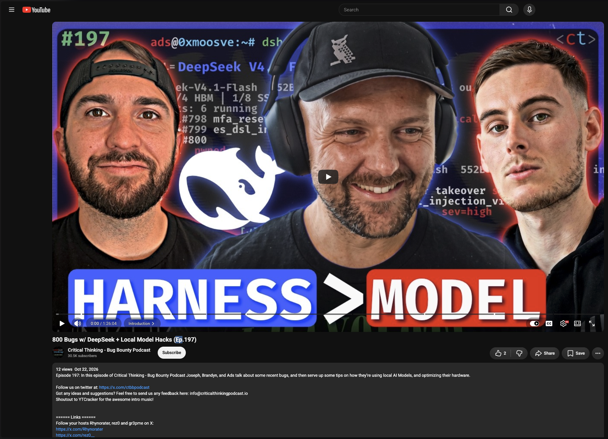
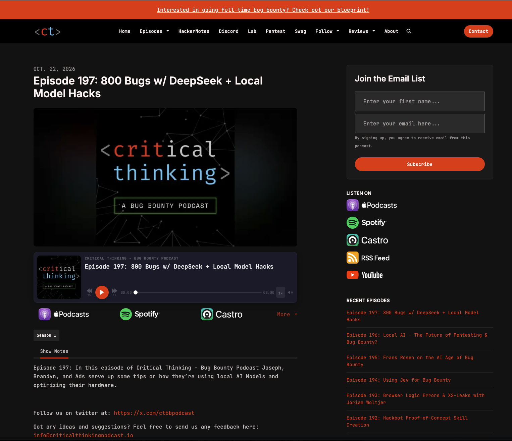
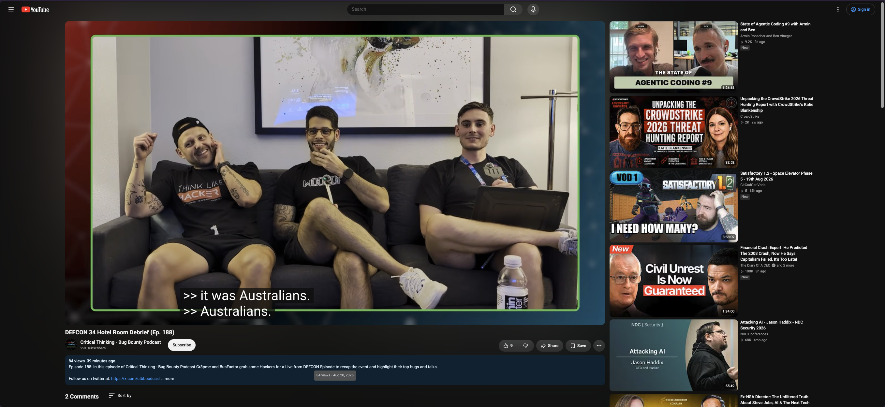
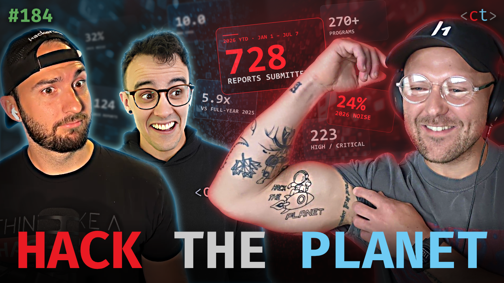
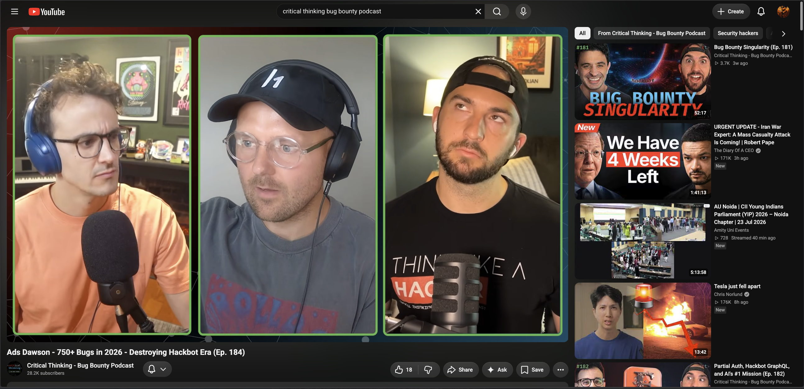
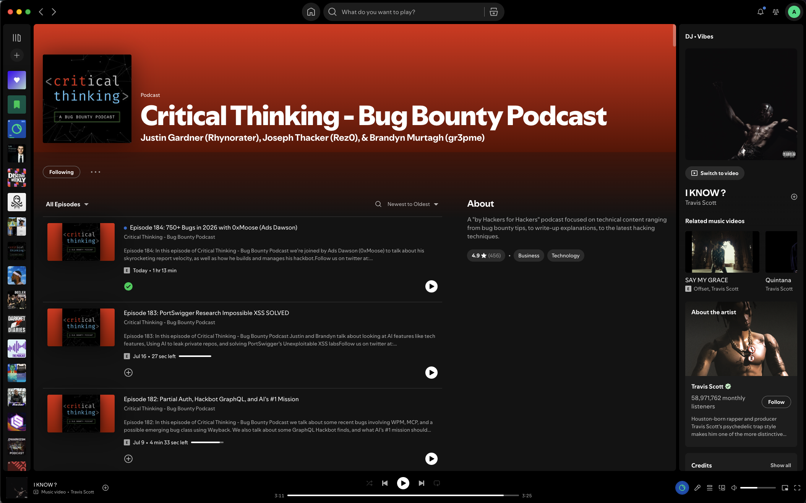
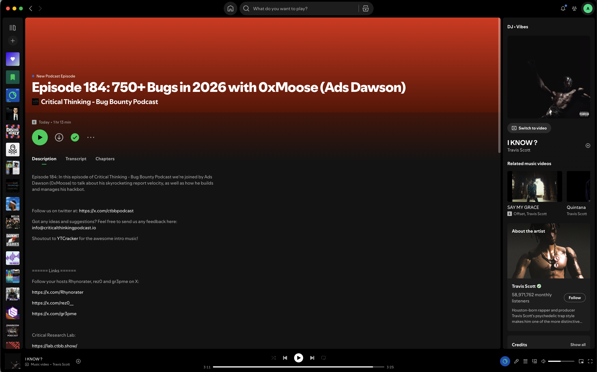
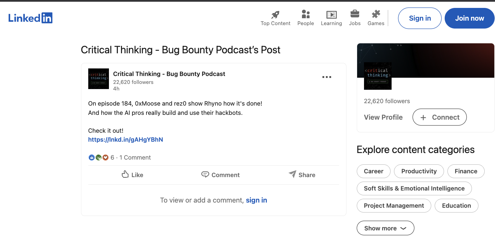

# [Critical Thinking - Bug Bounty Podcast](https://www.youtube.com/@criticalthinkingpodcast)

## Ep. 197: 800 Bugs w/ DeepSeek + Local Model Hacks | [Episode Link](https://www.criticalthinkingpodcast.io/800-bugs-w-deepseek-local-model-hacks/)

- **Episode:** Episode 197 — 800 Bugs w/ DeepSeek + Local Model Hacks
- **Date:** October 22, 2026
- **Hosts:** rez0 (Joseph Thacker), gr3pme (Brandyn)
- **Guest:** Ads Dawson (0xmoose)
- **Duration:** 1 hr 26 min 5 sec
- **Abstract:**

  Joseph, Brandyn, and Ads talk about some recent bugs, and then serve up some tips on how they're using local AI models and optimizing their hardware — harness over model. Ads breaks down hitting 800 bugs with DeepSeek-powered hackbots, the hardware and quantization tweaks behind running capable models locally, and the verifier/reflection agent design that keeps autonomous hunting signal high.

  Episode Timestamps

  - **(00:00:00)** Introduction
  - **(00:04:00)** Bugs found with DeepSeek
  - **(00:18:15)** Caido Race Conditions & Pipeline Session
  - **(00:23:47)** Free models in OpenCode, Reset months, and Overlapping Fragments
  - **(00:29:54)** Local Models & Hardware Optimization
  - **(00:46:53)** Verifiers & Reflections Agents
  - **(00:58:16)** Ohmypi, Herdr and other Harnesses
  - **(01:09:20)** Muse Spark Open & Stealth Bench, & DreadIndex
  - **(01:18:35)** Keeping agents from fighting

- 🍿 **Watch on YouTube** [800 Bugs w/ DeepSeek + Local Model Hacks (Ep.197)](https://www.youtube.com/watch?v=gKvIjE8LRVg)
- 🎧 **Listen on Spotify** [Ep. 197: 800 Bugs w/ DeepSeek + Local Model Hacks](https://open.spotify.com/episode/4p1S0PtlttE0nvyzJeVRxs)
- 🍎 **Listen on Apple Podcasts** [Ep. 197: 800 Bugs w/ DeepSeek + Local Model Hacks](https://podcasts.apple.com/us/podcast/episode-197-800-bugs-w-deepseek-local-model-hacks/id1663945029?i=1000797587403)
- 🎙️ **Podcast on Spotify (Show)** [Critical Thinking - Bug Bounty Podcast](https://open.spotify.com/show/4GiJnv8f4a4ZR6Jc6TQJ3k)
- 🌐 **Episode Page (HTML)** [ctbb-ep197-800-bugs-deepseek-local-model-hacks.html](ctbb-ep197-800-bugs-deepseek-local-model-hacks.html)
- 📺 **YouTube Page (HTML)** [ctbb-ep197-youtube.html](ctbb-ep197-youtube.html)

----------------------------------------

## Ep. 188: DEFCON 34 Hotel Room Debrief | [Episode Link](https://www.criticalthinkingpodcast.io/defcon-34-hotel-room-debrief/)

- **Episode:** Episode 188 — DEFCON 34 Hotel Room Debrief
- **Date:** August 2026
- **Hosts:** Gr3pme, BusFactor
- **Guests:** 7urb01, Ads Dawson
- **Duration:** 41 min 47 sec
- **Abstract:**

  Live from DEF CON 34 — Gr3pme and BusFactor grab some hackers for a hotel room debrief to recap the event and discuss top bugs discovered, talks presented, and key takeaways from the conference.

  Episode Timestamps

  - **(00:00:00)** Introduction
  - **(00:03:45)** DEFCON Event Reactions and Takeaways
  - **(00:12:56)** Bus & Turbo Talk Overviews
  - **(00:21:53)** Event Bugs

- 🍿 **Watch on YouTube** [Ep. 188: DEFCON 34 Hotel Room Debrief](https://www.youtube.com/watch?v=MmLGWGSV8lg)
- 🎧 **Listen on Spotify** [Ep. 188: DEFCON 34 Hotel Room Debrief](https://open.spotify.com/episode/0OsYXBZ4Cv92AhlSZvZOAD)
- 🍎 **Listen on Apple Podcasts** [Ep. 188: DEFCON 34 Hotel Room Debrief](https://podcasts.apple.com/us/podcast/episode-188-defcon-34-hotel-room-debrief/id1663945029?i=1000784510447)
- 🌐 **Episode Page (HTML)** [ctbb-ep188-defcon-34-hotel-room-debrief.html](ctbb-ep188-defcon-34-hotel-room-debrief.html)

----------------------------------------

## HackerNotes Ep. 184: Hackbots at Scale with Ads Dawson — Smaller Models, Bigger Signal | [Episode Link](https://blog.criticalthinkingpodcast.io/p/hackernotes-ep-184-hackbots-at-scale-with-ads-dawson-smaller-models-bigger-signal)

- **Episode:** HackerNotes Ep. 184 — Hackbots at Scale with Ads Dawson: Smaller Models, Bigger Signal
- **Date:** July 2026
- **Subtitle:** 750+ Bugs in 2026 with 0xmoose
- **Abstract:**

  Ads joins the Critical Thinking - Bug Bounty Podcast to break down how he scaled autonomous bug hunting to 728 reports submitted in 2026 YTD (roughly 5.9x his entire 2025 output) — all part-time, primarily using open-source and smaller models rather than expensive frontier APIs.

  The conversation covers the researcher-builder loop, where the real edge lies not in vulnerability detection alone but in verifier design, harness architecture, confidence thresholds, and feedback loops. Ads walks through AI-assisted reporting workflows where reports are 80%+ AI-written from refined skills, with per-program judges customizing output to match each program's preferences.

  Key Topics

  - **Scaling Bug Discovery:** 728 reports across 270+ programs in 2026 YTD, with 223 high/critical findings and only 24% noise — achieved through system architecture, not brute force.

  - **Researcher-Builder Loop:** The interesting work is moving into verifier design, harness shape, confidence thresholds, and feedback loops — the actual edge lies in system architecture.

  - **AI-Assisted Reporting:** Reports are 80%+ AI-written from one refined skill, with per-program judges customizing output to match each program's preferences.

  - **Meta's FBDL MCP:** Meta released an agentic tool enabling automated account creation and test data provisioning, with a 20% bonus incentive for reports using the system.

  - **CSS Injection Technique:** Detailed analysis of data exfiltration via `@font-face` and `unicode-range` rules, bypassing JavaScript-blocking CSPs.

  - **Model Economics:** Strong ROI achieved through open-source and smaller models (like Qwen) rather than relying on subsidized token pricing.

  - **Verification Systems:** Per-program reflection logs that track past failed attempts to prevent redundant testing.

- 📝 **Show Notes** [HackerNotes Ep. 184](https://blog.criticalthinkingpodcast.io/p/hackernotes-ep-184-hackbots-at-scale-with-ads-dawson-smaller-models-bigger-signal)
- 🍿 **Watch on YouTube** [Ads Dawson - 750+ Bugs in 2026 - Destroying Hackbot Era (Ep. 184)](https://www.youtube.com/watch?v=0olk6lC1AGg)
- 🎧 **Listen on Spotify** [HackerNotes Ep. 184](https://open.spotify.com/episode/2QfwAwWuVgj4iDqi8Fm9WM?si=0352f6431a80460e)
- 📄 **Episode Notes (PDF)** [hackernotes-ep184-hackbots-at-scale-ads-dawson.pdf](hackernotes-ep184-hackbots-at-scale-ads-dawson.pdf)
- 🌐 **Episode Notes (HTML)** [hackernotes-ep184-hackbots-at-scale-ads-dawson.html](hackernotes-ep184-hackbots-at-scale-ads-dawson.html)
- **Social Links** [https://www.linkedin.com/posts/on-episode-184-0xmoose-and-rez0-show-rhyno-share-7485997447681331200--e2n/?utm_source=share&utm_medium=member_android&rcm=ACoAAA1p028B5AHnJgHCbLKDdcDTNnvyDWkUwzE](https://www.linkedin.com/posts/on-episode-184-0xmoose-and-rez0-show-rhyno-share-7485997447681331200--e2n/?utm_source=share&utm_medium=member_android&rcm=ACoAAA1p028B5AHnJgHCbLKDdcDTNnvyDWkUwzE)

----------------------------------------
