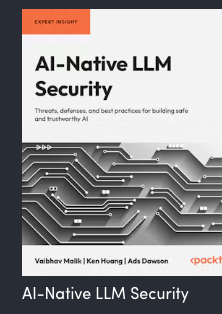
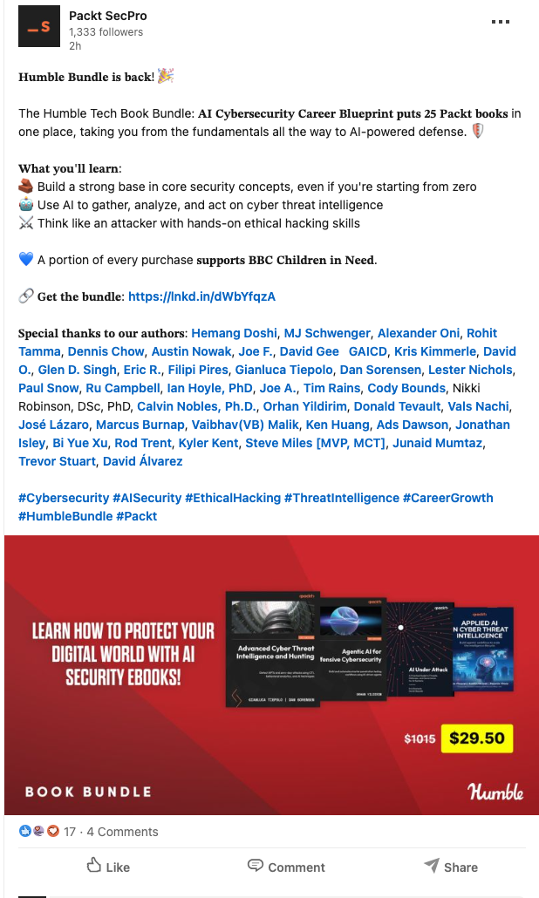

# [AI Native LLM Security](https://www.packtpub.com/en-ca/product/ai-native-llm-security-9781836203742)

## 📚 Packt Publishing (2025) — featured in the Humble Tech Book Bundle

Ads Dawson (0xmoose) is a co-author of **AI Native LLM Security** (Packt, 2025) — a practitioner's guide to adversarial AI attacks, LLM threat modeling, and secure-by-design defenses — written alongside co-authors **Vaibhav Malik** and **Ken Huang**.

In November 2026 the book was selected for Humble Bundle's **Humble Tech Book Bundle: AI Cybersecurity Career Blueprint by Packt** — a 25-book, pay-what-you-want collection whose proceeds support charity.

### Featured in the Humble Bundle

Humble Bundle curated *AI Native LLM Security* into its **AI Cybersecurity Career Blueprint** bundle — 25 Packt titles spanning cybersecurity fundamentals through AI-powered offense and defense, under Humble's "pay what you want and help charity" model.

- **Bundle:** Humble Tech Book Bundle — *AI Cybersecurity Career Blueprint* by Packt
- **Ads's title included:** *AI Native LLM Security* (in the full 25-item tier)
- **Contents:** 25 Packt eBooks (PDF / ePUB), offered in 3-, 6-, and 25-item tiers — full bundle from **$25**, against a total value of **$1,015**
- **Model:** Pay what you want — buyers choose how the split goes to publishers, Humble, and charity
- **Charity:** A portion of every purchase supports **BBC Children in Need**
- **Theme:** "Defend your digital world with AI" — fundamentals, AI-driven threat intelligence, and hands-on ethical hacking

### About the Book

*AI Native LLM Security* equips security professionals, AI practitioners, and engineering leaders to secure systems built on large language models. It covers:

- **Adversarial AI attacks** — understanding the offensive techniques used against LLM-powered systems to strengthen defensive posture
- **Emerging LLM threats** — insights from LLM security experts on navigating a fast-moving threat landscape
- **Secure-by-design and MLSecOps** — practical strategies and operational practices for building robust, trustworthy AI systems

**Audience:** CISOs, security architects, ML engineers, data scientists, and DevOps professionals responsible for developing and securing AI applications. A basic grounding in security concepts and AI fundamentals is assumed.

Ads's contribution reflects his work founding the **OWASP GenAI Security Project** and leading the **OWASP Top 10 for LLM Applications**.

### The Announcement

Packt SecPro announced the bundle across social, thanking the authors — Ads Dawson among them — and highlighting the charity tie-in with BBC Children in Need.

### Links

- **Book (Packt):** [AI Native LLM Security](https://www.packtpub.com/en-ca/product/ai-native-llm-security-9781836203742)
- **Humble Bundle:** [AI Cybersecurity Career Blueprint (Packt)](https://www.humblebundle.com/books/ai-cybersecurity-career-blueprint-packt-books)
- **Packt SecPro announcement:** [LinkedIn post](https://lnkd.in/p/eut-x9JM)
- **Local bundle page archive (HTML):** [humble-bundle-ai-cybersecurity-career-blueprint.html](humble-bundle-ai-cybersecurity-career-blueprint.html)
- **Local announcement archive (HTML):** [packt-secpro-humble-bundle-linkedin-post.html](packt-secpro-humble-bundle-linkedin-post.html)

> **Status:** Published — co-author of *AI Native LLM Security* (Packt, 2025). Selected for Humble Bundle's *AI Cybersecurity Career Blueprint* 25-book collection (November 2026), supporting BBC Children in Need. Local HTML archives and browser screenshots (bundle hero, book cover, Packt SecPro announcement) saved.
