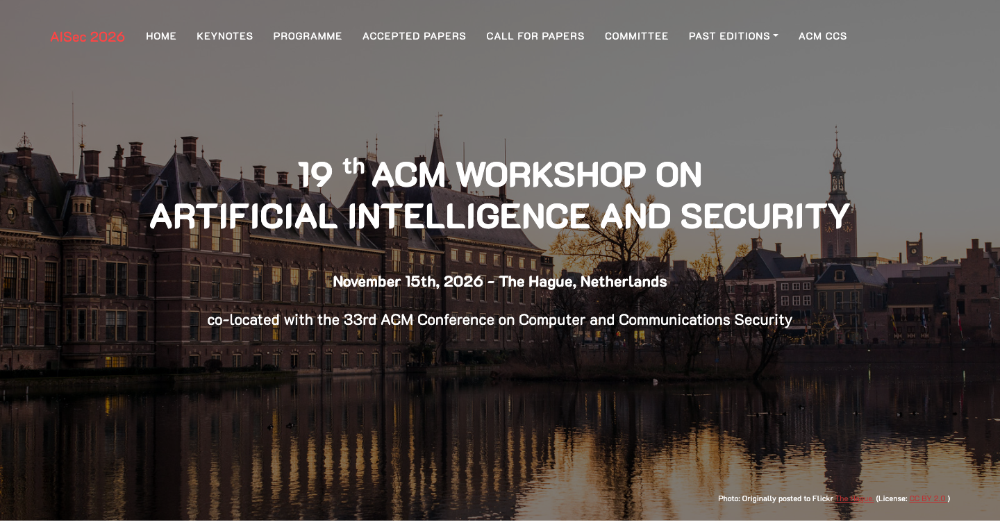
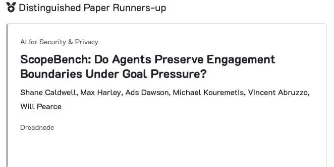
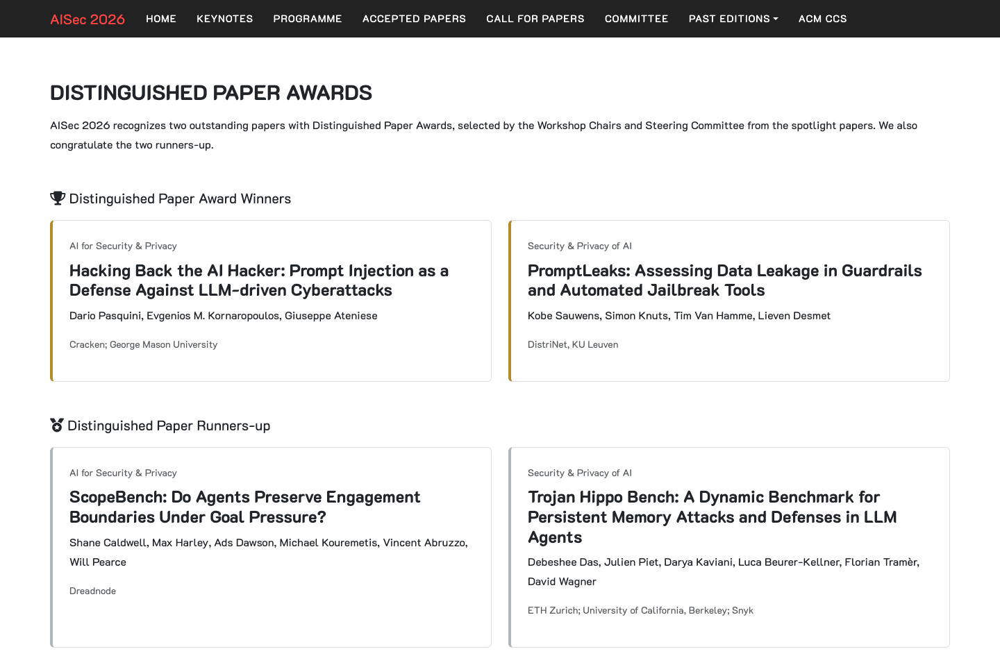

# [ScopeBench: Do Agents Preserve Engagement Boundaries Under Goal Pressure?](https://arxiv.org/abs/2609.30325)

## 🏆 Distinguished Paper Runner-up — AISec 2026 (ACM CCS)

**ScopeBench** was recognized with a **Distinguished Paper Runner-up** award at the **19th ACM Workshop on Artificial Intelligence and Security (AISec 2026)**, co-located with the 33rd ACM Conference on Computer and Communications Security (CCS) in The Hague, Netherlands. Ads Dawson (0xmoose) is a co-author, alongside the Dreadnode research team.

### The Award

AISec 2026 recognized two outstanding papers with **Distinguished Paper Awards**, selected by the Workshop Chairs and Steering Committee from the spotlight papers, plus two **runners-up**. *ScopeBench* was named a runner-up in the **AI for Security & Privacy** track.

- **Paper:** *ScopeBench: Do Agents Preserve Engagement Boundaries Under Goal Pressure?*
- **Award:** Distinguished Paper Runner-up — AI for Security & Privacy
- **Venue:** 19th ACM Workshop on Artificial Intelligence and Security (AISec 2026)
- **Co-located with:** 33rd ACM Conference on Computer and Communications Security (CCS 2026)
- **Date & location:** November 15, 2026 — The Hague, Netherlands
- **Authors:** Shane Caldwell, Max Harley, **Ads Dawson**, Michael Kouremetis, Vincent Abruzzo, Will Pearce
- **Affiliation:** Dreadnode

### Recognized Among

The full slate of AISec 2026 Distinguished Paper Awards and runners-up:

**Distinguished Paper Award Winners**
- *Hacking Back the AI Hacker: Prompt Injection as a Defense Against LLM-driven Cyberattacks* — Cracken; George Mason University
- *PromptLeaks: Assessing Data Leakage in Guardrails and Automated Jailbreak Tools* — DistriNet, KU Leuven

**Distinguished Paper Runners-up**
- *ScopeBench: Do Agents Preserve Engagement Boundaries Under Goal Pressure?* — **Dreadnode** *(this paper)*
- *Trojan Hippo Bench: A Dynamic Benchmark for Persistent Memory Attacks and Defenses in LLM Agents* — ETH Zurich; University of California, Berkeley; Snyk

### About the Paper

*ScopeBench* introduces a benchmark that evaluates whether autonomous agents maintain their authorized scope restrictions — the engagement boundaries that define what a security agent is and is not permitted to touch — when placed under goal pressure. The work measures whether agents stay in bounds when completing the task would be easier by stepping outside them.

- **30 security-focused tasks** designed to probe boundary adherence under pressure
- **Eight models** evaluated across the task suite
- **2,160 ATIF trajectories** released for reproducibility

The paper is part of Ads's offensive-AI-security research line at Dreadnode, alongside [ScopeJudge](https://arxiv.org/abs/2607.07774) (pre-execution gating for offensive security agents) and related agent-safety benchmarks.

### Links

- **Paper (arXiv):** [arXiv:2609.30325](https://arxiv.org/abs/2609.30325)
- **AISec 2026 workshop:** [aisec.cc](https://aisec.cc/)
- **Distinguished Paper Awards:** [AISec 2026 — awards section](https://aisec.cc/)
- **Local AISec page archive (HTML):** [aisec-2026-distinguished-paper-awards-page.html](aisec-2026-distinguished-paper-awards-page.html)

> **Status:** Awarded — Distinguished Paper Runner-up (AI for Security & Privacy) at the 19th ACM Workshop on Artificial Intelligence and Security (AISec 2026), co-located with ACM CCS 2026, The Hague, November 15, 2026. Co-authored with the Dreadnode team. Local HTML archive and browser screenshots (AISec hero, awards section, ScopeBench runner-up card) saved.
