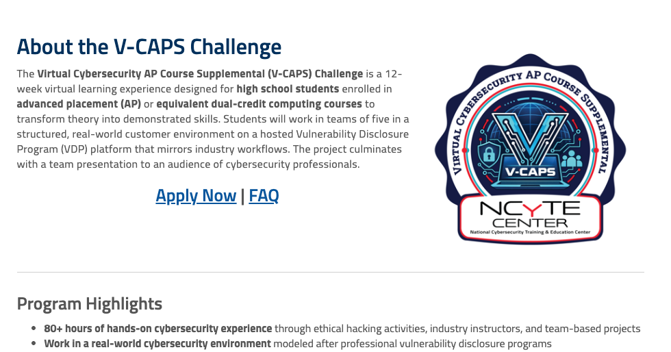
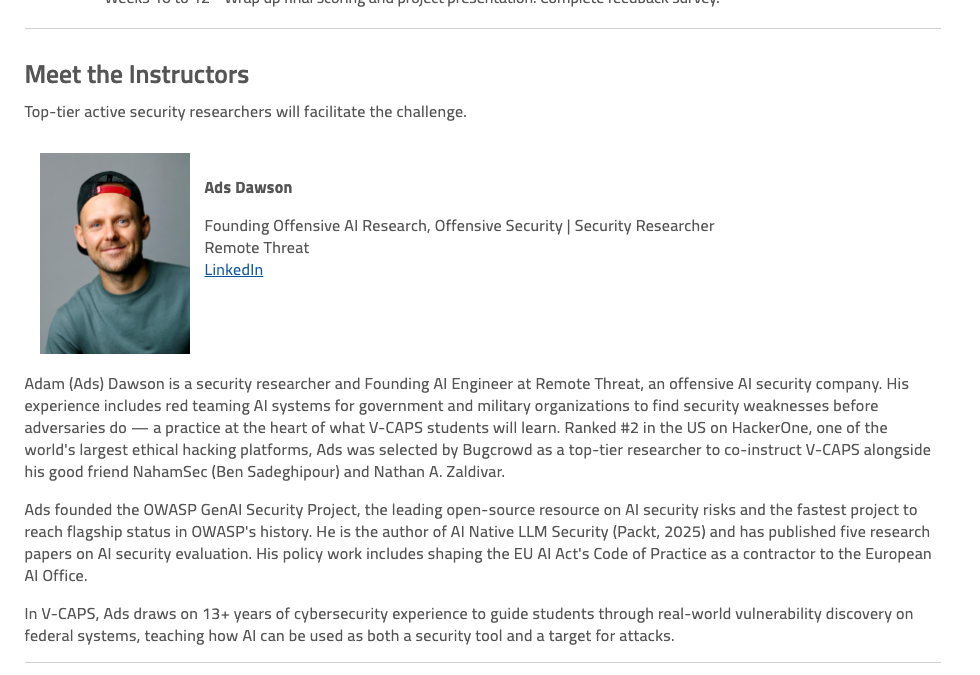
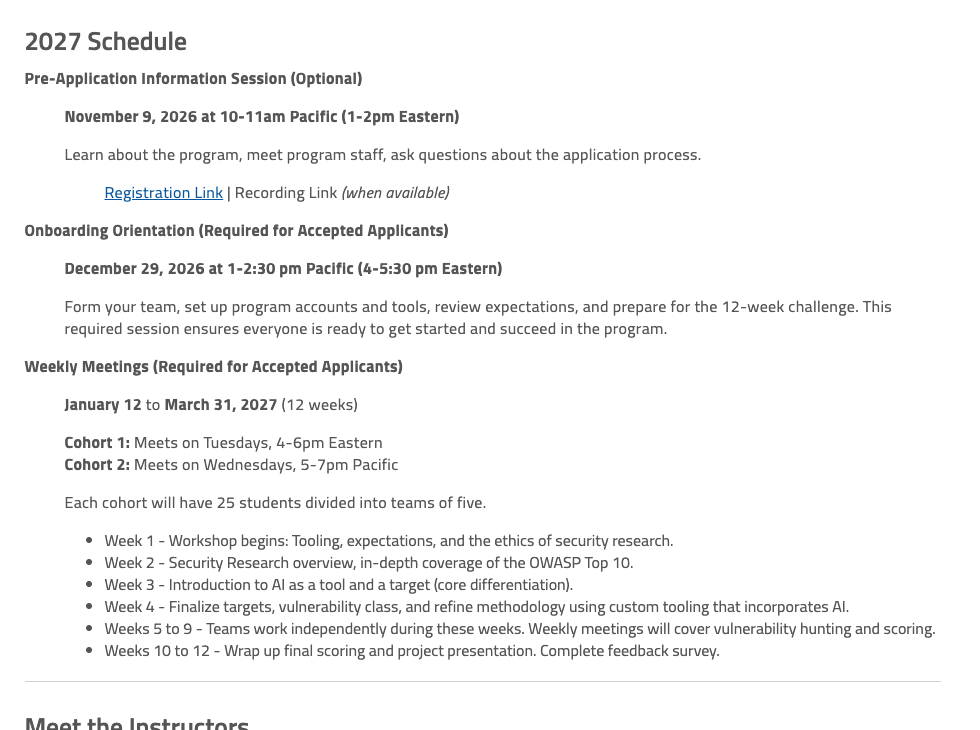

# [V-CAPS: Virtual Cybersecurity AP Course Supplemental](https://www.ncyte.net/career-seekers/career-seeker-resources/virtual-cybersecurity-ap-course-supplemental)

## 🎓 Instructor — NCyTE Center (Jan–Mar 2027)

Ads Dawson (0xmoose) was **selected by Bugcrowd as a top-tier security researcher to co-instruct V-CAPS** — the NCyTE Center's **Virtual Cybersecurity AP Course Supplemental** — teaching high-school Advanced Placement students real-world vulnerability discovery and AI security, alongside **Ben Sadeghipour (NahamSec)** and **Nathan Miranda (rye)**.

V-CAPS is a National Science Foundation–funded program run by the National Cybersecurity Training & Education (NCyTE) Center, hosted at Whatcom Community College. Being chosen to instruct it places Ads among the active, top-tier researchers trusted to train the next generation of ethical hackers.

### About the Program

The Virtual Cybersecurity AP Course Supplemental (V-CAPS) Challenge is a **12-week virtual learning experience** designed for high-school students enrolled in Advanced Placement (AP) or equivalent dual-credit computing courses, to transform theory into demonstrated skills. Students work in **teams of five** inside a structured, real-world customer environment on a hosted **Vulnerability Disclosure Program (VDP)** platform that mirrors industry workflows, culminating in a team presentation to an audience of cybersecurity professionals.

- **Role:** Instructor / Co-Instructor — selected by Bugcrowd as a top-tier researcher
- **Organization:** NCyTE Center (National Cybersecurity Training & Education Center), hosted at Whatcom Community College
- **Program:** V-CAPS — Virtual Cybersecurity AP Course Supplemental
- **Format:** 12 weeks · 80+ hours hands-on · teams of five · hosted VDP platform · final showcase
- **Audience:** High-school AP / dual-credit students (U.S. citizens, nationals, or lawful permanent residents)
- **Cohort window:** January 12 – March 31, 2027
- **Co-Instructors:** Ben Sadeghipour (NahamSec) · Nathan Miranda (rye)
- **Funding:** Supported by the U.S. National Science Foundation (NSF Grants #2054724 and #2600198)

### Ads's Role

As listed on the NCyTE V-CAPS page:

> Adam (Ads) Dawson is a security researcher and Founding AI Engineer at Remote Threat, an offensive AI security company. His experience includes red teaming AI systems for government and military organizations to find security weaknesses before adversaries do — a practice at the heart of what V-CAPS students will learn. … Ads was selected by Bugcrowd as a top-tier researcher to co-instruct V-CAPS alongside his good friend NahamSec (Ben Sadeghipour) and Nathan A. Zaldivar.
>
> In V-CAPS, Ads draws on 13+ years of cybersecurity experience to guide students through real-world vulnerability discovery on federal systems, teaching how AI can be used as both a security tool and a target for attacks.

Ads's instruction anchors the program's AI differentiation: **Week 3** introduces AI as both a tool and a target, and **Week 4** has teams refine methodology using custom tooling that incorporates AI — directly reflecting his work founding the OWASP GenAI Security Project and authoring *AI Native LLM Security* (Packt, 2025).

### Program Highlights

- **80+ hours of hands-on cybersecurity experience** through ethical hacking activities, industry instructors, and team-based projects
- **Work in a real-world cybersecurity environment** modeled after professional vulnerability disclosure programs
- **Learn from active top-tier security researchers** through weekly meetings, guidance, and feedback
- **Build practical skills** in vulnerability assessment, penetration testing, and secure software development
- **Collaborate on a team of five students** to research, identify, and report security issues
- **Present your work to cybersecurity professionals** during the program's final showcase
- **Explore cybersecurity career pathways** and connect with industry experts

### Curriculum (12 Weeks)

- **Week 1** — Workshop begins: tooling, expectations, and the ethics of security research
- **Week 2** — Security research overview; in-depth coverage of the OWASP Top 10
- **Week 3** — Introduction to AI as a tool and a target (core differentiation)
- **Week 4** — Finalize targets and vulnerability class; refine methodology using custom tooling that incorporates AI
- **Weeks 5–9** — Teams work independently; weekly meetings cover vulnerability hunting and scoring
- **Weeks 10–12** — Wrap up final scoring and project presentation; complete feedback survey

### What Students Earn

- **Certificate of Completion** — aligned with the Penetration Tester and Vulnerability Assessment Analyst work roles
- **Real-world project experience** for college, scholarship, and career applications
- **Professional skills** in teamwork, communication, problem-solving, and ethical cybersecurity research
- **Stipend** — up to $1,725 for participants who meet attendance requirements and complete all program milestones

### Key Dates (2027 Cohort)

- **Pre-Application Information Session (optional):** November 9, 2026 — 10–11am Pacific
- **Onboarding Orientation (required):** December 29, 2026 — 1–2:30pm Pacific
- **Weekly Meetings:** January 12 – March 31, 2027 (12 weeks)
  - **Cohort 1:** Tuesdays, 4–6pm Eastern
  - **Cohort 2:** Wednesdays, 5–7pm Pacific
  - Each cohort: 25 students, divided into teams of five

### Links

- **Program page:** [ncyte.net — V-CAPS](https://www.ncyte.net/career-seekers/career-seeker-resources/virtual-cybersecurity-ap-course-supplemental)
- **NCyTE Center:** [ncyte.net](https://www.ncyte.net/)
- **Local page archive (HTML):** [v-caps-ncyte-page.html](v-caps-ncyte-page.html)

> **Status:** Upcoming — 2027 cohort. Instructor role confirmed and listed on the NCyTE V-CAPS page alongside NahamSec and rye. Program funded by the U.S. National Science Foundation (NSF Grants #2054724 and #2600198). Local HTML archive and browser screenshots (About/badge, instructor card, 2027 schedule) saved.
